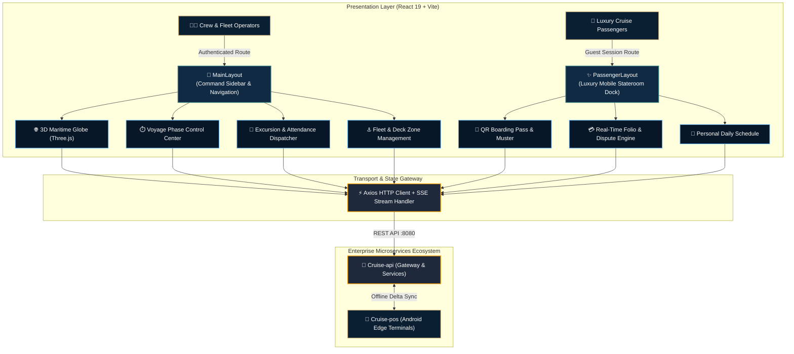

<div align="center">


<br />

# ⚓ CRUISE-WEB
### Operations Command Deck & Luxury Passenger Digital Twin

**An open enterprise frontend ecosystem engineered for luxury cruise fleets.**  
Unifying real-time fleet command telemetry, interactive 3D vessel digital twin, voyage global lifecycle orchestration, and a standalone mobile-first guest experience portal.

<br />

<p align="center">
  <a href="https://react.dev/">
    
  </a>
  <a href="https://www.typescriptlang.org/">
    
  </a>
  <a href="https://vite.dev/">
    
  </a>
  <a href="https://tailwindcss.com/">
    
  </a>
  <a href="https://threejs.org/">
    
  </a>
  <a href="https://vitest.dev/">
    
  </a>
  <a href="https://tanstack.com/query">
    
  </a>
  <a href="https://github.com/Cruise-JavaCLass/Cruise-web/blob/main/LICENSE">
    
  </a>
</p>

</div>

---

## 🌟 Executive Summary & Dual-Portal Architecture

`Cruise-web` provides a unified single-page architecture with two strictly decoupled operational domains:

<table>
  <thead>
    <tr>
      <th width="50%">🚢 Fleet Operations Command Deck</th>
      <th width="50%">✨ Luxury Guest Experience Portal</th>
    </tr>
  </thead>
  <tbody>
    <tr>
      <td valign="top">
        <b>Target:</b> Captain, Chief Purser, Tour Guides & Port Coordinators.<br /><br />
        <ul>
          <li><b>3D Maritime Digital Twin:</b> Interactive WebGL dot-matrix globe visualizing vessel position, navigation waypoints, and port stops.</li>
          <li><b>Voyage Global Lifecycle Stepper:</b> Phase transition coordinator enforcing strict operational gates from <code>SCHEDULED</code> to <code>CLOSED</code>.</li>
          <li><b>Maritime Timezone Synchronizer:</b> Ship clock and port timezone offset scheduler for international boundary crossings.</li>
          <li><b>Shore Excursion Roster:</b> Bus dispatching, capacity quotas, and real-time QR attendance check-in.</li>
          <li><b>RFID / NFC Pool Inventory:</b> Contactless passenger badge pairing, lost-card blacklisting, and security watchdog.</li>
        </ul>
      </td>
      <td valign="top">
        <b>Target:</b> Passengers, Families, VIP Guests (Mobile-First / Tablet).<br /><br />
        <ul>
          <li><b>Standalone Luxury Layout:</b> Editorial neo-brutalist guest viewport isolated from internal administrative sidebars.</li>
          <li><b>Digital Boarding Pass:</b> High-contrast QR/Aztec pass with stateroom number, emergency muster station, and boarding group.</li>
          <li><b>Real-Time Stateroom Folio:</b> Live expense stream, itemized onboard dining charges, and instant dispute submission.</li>
          <li><b>Daily Interactive Itinerary:</b> Personal daily schedule, gala dinners, Broadway shows, and shore excursions.</li>
          <li><b>Touch-Friendly E-Signature:</b> Gesture-guarded canvas with <code>touch-action: none</code> for frictionless cabin charging.</li>
        </ul>
      </td>
    </tr>
  </tbody>
</table>

---

## 🏛️ System Architecture & Data Topology



---

## 🗺️ Application Routes & Functional Matrix

| Route | Viewport / Persona | Module & Core Features | State & Persistence |
| :--- | :--- | :--- | :--- |
| **`/`** | Crew / Desktop | **Fleet Operations Dashboard:** Live maritime radar, 3D interactive vessel globe, fleet occupancy KPI, and port weather. | TanStack Query + SSE |
| **`/voyage`** | Crew / Desktop | **Voyage Lifecycle Control Center:** Global state machine stepper (`EMBARKATION` $\rightarrow$ `AT_SEA` $\rightarrow$ `PORT_VISIT` $\rightarrow$ `DEBARKING`), port timezone coordinator. | REST API + State Machine |
| **`/ships`** | Crew / Desktop | **Fleet Specification Management:** Hull dimensions, beam, draft, passenger/crew ratios, and deck cabin inventories. | Modal Form + Validation |
| **`/admin/cruise-area-policies`** | Crew / Desktop | **Maritime Area & Cancellation Policies:** Regional cruise zones, dynamic cancellation penalties, and weather advisories. | REST API + Policy Engine |
| **`/itinerary`** | Crew / Desktop | **Voyage Itinerary & Timeline:** Chronological ports of call, docking/undocking timetables, and audit history comparison. | Timeline Drag & Audit Log |
| **`/excursions`** | Crew / Desktop | **Shore Excursion Catalog & Dispatch:** Partner tour directory, bus allocation, pricing, and all-aboard deadlines. | Filtered Roster + Quotas |
| **`/excursion-attendance`** | Crew / Tablet | **Excursion Roster Check-in:** Real-time QR scanner and RFID tap attendance verification for departing buses. | Camera Viewfinder + Sync |
| **`/passengers`** | Crew / Desktop | **Passenger Identity & Card Pool:** Cabin assignments, blank RFID card batch ingestion, and lost-badge blacklisting. | Search & Batch Actions |
| **`/pos`** | Crew / Tablet | **Web Cashless POS & Folio Tender:** Stateroom checkout, digital e-signature pad with gesture lock, and receipt printing. | Touch-Safe Canvas Pad |
| **`/passenger-home`** | Guest / Mobile | **Luxury Guest Hub:** Personalized cabin welcome, onboard credit (OBC) balance pill, and vessel weather widget. | Standalone Luxury Theme |
| **`/boarding-pass`** | Guest / Mobile | **Digital Boarding Pass:** High-contrast offline QR pass with muster station designation and boarding group badge. | SVG Barcode Renderer |
| **`/my-schedule`** | Guest / Mobile | **Personal Itinerary:** Booked excursions, spa appointments, and theater reservations with countdown alerts. | Reactive Schedule Grid |
| **`/passenger/folio`** | Guest / Mobile | **Real-Time Stateroom Folio:** Itemized transaction ledger, instant dispute filing, and split-cabin preview. | Folio Stream + E-Receipts |

---

## 🎨 Luxury Maritime & Soft Editorial Design System

The visual identity is custom-crafted to reflect the prestige of international superyachts and luxury ocean liners:

<table>
  <thead>
    <tr>
      <th width="20%">Color Token</th>
      <th width="15%">Hex Value</th>
      <th width="20%">Swatch</th>
      <th width="45%">Design Role & Application</th>
    </tr>
  </thead>
  <tbody>
    <tr>
      <td><b>Primary Ocean Navy</b></td>
      <td><code>#102A43</code></td>
      <td></td>
      <td>Command headers, primary action buttons, strong brand typography.</td>
    </tr>
    <tr>
      <td><b>Deep Maritime Abyss</b></td>
      <td><code>#0B1F33</code></td>
      <td></td>
      <td>3D Canvas backdrop, modal overlays, high-contrast dark accents.</td>
    </tr>
    <tr>
      <td><b>Champagne Gold</b></td>
      <td><code>#C5A572</code></td>
      <td></td>
      <td>Luxury badges, status rings, interactive icons, active navigation indicators.</td>
    </tr>
    <tr>
      <td><b>Maritime Telemetry Teal</b></td>
      <td><code>#397C80</code></td>
      <td></td>
      <td>Active voyage phases, GPS indicators, onboard safety sensors, live status.</td>
    </tr>
    <tr>
      <td><b>Soft Editorial Sand</b></td>
      <td><code>#F7F4ED</code></td>
      <td></td>
      <td>Warm tactile card backgrounds, secondary containers, paper-like luxury surfaces.</td>
    </tr>
    <tr>
      <td><b>Crisp Travertine Border</b></td>
      <td><code>#E5E0D7</code></td>
      <td></td>
      <td>Subtle, razor-sharp structural divider borders (1px solid).</td>
    </tr>
  </tbody>
</table>

---

## 🛠️ Developer Quick Start & Tooling

### Prerequisites
* **Node.js:** v22.x or later
* **npm:** v10.x or later

### Installation & Launch
```bash
# 1. Clone repository and navigate to directory
git clone https://github.com/Cruise-JavaCLass/Cruise-web.git
cd Cruise-web

# 2. Install dependencies cleanly
npm install

# 3. Start local development server with Hot Module Replacement
npm run dev
```
> The application will initialize at **`http://localhost:3000`** with immediate proxying to Backend Gateway at `http://localhost:8080`.

### Production Build & Preview
```bash
# Typecheck and compile optimized production bundle into /dist
npm run build

# Preview production build locally
npm run preview
```

---

## 🧪 Testing Suite & Quality Assurance

The codebase enforces strict unit, integration, and component testing via **Vitest** and **React Testing Library**:

| Command | Target | Description |
| :--- | :--- | :--- |
| `npm test` | All Suites | Headless single-pass test execution with standard exit codes. |
| `npm run test:watch` | Interactive | Hot-reloading test runner for ongoing feature development. |
| `npm run test:coverage` | V8 Coverage | Generates statement, branch, and function coverage reports at `./coverage`. |
| `npm run test:ui` | Browser UI | Launches interactive visual test explorer in browser. |
| `npm run test:ci` | CI Pipeline | High-verbosity reporting with strict failure thresholds for GitHub Actions. |

```bash
# Run targeted tests for a specific operational module
npx vitest run src/components/voyage/VoyageLifecycle.test.tsx
npx vitest run src/pages/PassengersPage.test.tsx
```

---

## 🚀 Git Strategy & CI/CD Pipeline

Development strictly adheres to **GitHub Flow** and **Conventional Commits**:

* **Feature Branches:** `feature/<JIRA-KEY>-<short-description>`
* **Bugfix Branches:** `bugfix/<JIRA-KEY>-<short-description>`
* **Commit Specification:** `[<JIRA-KEY>] <type>(<scope>): <imperative summary>`
* **Continuous Integration:** Every PR automatically triggers GitHub Actions running:
  1. `Oxlint` static AST analysis & syntax validation.
  2. `TypeScript` strict compiler verification (`tsc --noEmit`).
  3. `Vitest` unit and integration test suite with coverage thresholds.
  4. `Vite` production bundle build verification.

---

<br />

<div align="center">

**[Cruise Hospitality Technology](https://github.com/Cruise-JavaCLass)** &bull; Engineered for Luxury Maritime Operations  
<sub>Cruise Management System &copy; 2026. Distributed under the MIT License.</sub>

</div>
